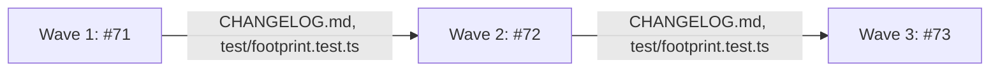

# footprint


**Know what you're about to merge.**

`footprint` reads a pull request's diff and answers two questions:

- **What does this change touch?** Its composition by file kind, the exported symbols it adds, removes or re-signs and where each is called from, and what landing it takes.
- **What else is moving?** The other open pull requests that change the same files, whether they touch the same symbols there, and an order they could land in.

Every figure comes from git, graft or `gh` and is computed, never estimated. footprint reports what it finds; the decision stays with you.

## Run it

```bash
git footprint                          # compare the default branch to HEAD; JSON Lines on stdout
git footprint origin/main              # an explicit base, compared from the merge base
git footprint abc123..def456           # an explicit range
git footprint --human > report.md      # the Markdown report
git footprint comment 42 --report report.md --change "First report" --reason "Pull request opened"
                                       # post it as pull request 42's one Footprint comment
git-footprint --help                   # every command and what it emits, as JSON Lines
```

_Listing 1. The commands. `git footprint` is the installed form; the clone form is `bun src/cli.ts` with the same arguments._

| How you have it | Run |
| --- | --- |
| Installed with `bun add -g @flyingrobots/footprint` | `git footprint`, which git finds as the `git-footprint` binary |
| Not installed | `bunx @flyingrobots/footprint` |
| A clone of this repository | `bun src/cli.ts` |

_Table 1. Three ways to run footprint. All three take the same arguments; footprint runs on Bun, not Node._

- **Help:** run `git-footprint --help`. git turns `git footprint --help` into a man-page lookup that never reaches footprint.
- **macOS:** never type a bare `footprint`. `/usr/bin/footprint` is an unrelated Apple memory tool that comes first on `PATH`.
- **Agents:** the skill in [`skills/footprint/SKILL.md`](skills/footprint/SKILL.md) covers the whole pull-request workflow, from the run to the posted comment.

## What it reports

One run writes four results, each its own JSON Lines record with its own schema, and `--human` renders each as a section of one Markdown comment.

| Result | Section | What it says |
| --- | --- | --- |
| `footprint.composition` | Composition | Files and changed lines by kind (source, test, docs, config, CI, generated, assets), the gut-check flags, and graft's structural summary |
| `footprint.landing` | Before merge, After merge | Migrations, generated files and manifests without their lockfile; then the after-merge steps quoted from the repository's own `RELEASE.md` and `AGENTS.md` |
| `footprint.blast_radius` | Blast radius | The exported symbols added, removed or re-signed, each with its call sites grouped by system |
| `footprint.overlap` | Open pull requests | The open pull requests that share a file with this one, each shared file compared at the symbol level, and proposed merge waves |

_Table 2. The four results of one run. Each states its own limits: a section that could not be computed says why, rather than disappearing._

The details live in the topic docs: [composition](docs/topics/composition/README.md), [landing](docs/topics/landing/README.md), [blast radius](docs/topics/blast-radius/README.md), [overlap](docs/topics/overlap/README.md), [output](docs/topics/output/README.md) and [the comment](docs/topics/comment/README.md).

### What else is moving

The overlap result compares this change with every open pull request. Where two share a file, footprint attributes each side's changed lines to the top-level symbols graft finds there, and reports the file as `symbol-disjoint`, `symbol-overlapping` or `undetermined`. Overlapping and undetermined files put the two pull requests in different waves; disjoint ones do not.



_Figure 1. The waves footprint proposed for three of its own pull requests, #71, #72 and #73. All three shared two files it could not compare by symbol, so it placed them one after another._

Overlap is evidence of possible interference, not proof of a conflict: nothing is merged or rebased to find it. Open pull requests and their files come from `gh`. If `gh` is absent or cannot answer, the result says so with `gh`'s own message, because an empty section would read as "nothing overlaps".

### What this change touches

- **Composition.** Totals come from `git diff --numstat`, and a test holds the category rows to the reported total. The rule exists because the first, hand-written version reported `+151` for a `+157` change.
- **Blast radius.** The symbols come from graft's `struct exports` contract. The call sites are footprint's own: every whole-word occurrence of the name in the tracked files, which is `grep -w`'s rule. That count includes the declaration, comments and prose, and cannot see dynamic dispatch, so it is evidence a reviewer can check with one `grep`, not a call graph.
- **Landing.** Merging is not landing. Before merge, footprint names what the changed paths show by documented patterns. After merge, it quotes the steps a repository declares, citing file and heading, and invents none.

graft is optional. Without it, the report says the structural and blast-radius sections are unavailable and why, instead of leaving them out. Both `bun install` and `npm install` get it; this repository's `.npmrc` skips a native build graft's dependency chain cannot complete on newer Node, and nothing footprint uses needs it.

## Evidence, not authority

> "You see, but you do not observe," the detective remarked, laying the report upon the table.
> "Here are the files the change has handled, the symbols it has moved, and the other hands at
> work upon the same papers. I have set down what the ground shows, and no more. Whether the man
> is to be taken up is a matter for the inspector."

footprint is that report, and never the arrest. It has no severity, no score, no pass or fail, and no threshold a pipeline could switch on. A large change is not automatically risky, and a one-line change to an authorisation check outweighs a thousand lines of prose. Read the evidence, then decide. A report built to be a gate gets gamed, and stops meaning anything.

## Direction

Not shipped yet, each tracked by an issue:

- Whether each overlapping pair of pull requests actually merges cleanly, from `git merge-tree` ([#79](https://github.com/flyingrobots/footprint/issues/79), [#80](https://github.com/flyingrobots/footprint/issues/80)).
- Each changed symbol's call sites counted as test and non-test ([#81](https://github.com/flyingrobots/footprint/issues/81)).
- The CODEOWNERS of each system a changed symbol is called from ([#85](https://github.com/flyingrobots/footprint/issues/85)).
- Open pull requests that add a call to a symbol this change removes or re-signs ([#88](https://github.com/flyingrobots/footprint/issues/88)).

## Status

**v0.7.1** is published on npm as `@flyingrobots/footprint`. A release is published on GitHub when its tag is pushed, and the npm version is staged for the owner to approve ([the release workflow](docs/workflows/release/README.md)). Changes since the release are in the [changelog](CHANGELOG.md).

## Docs

- [Documentation index](docs/README.md)
- [Working agreement](AGENTS.md)

## License

[Apache-2.0](LICENSE). See [NOTICE](NOTICE).
